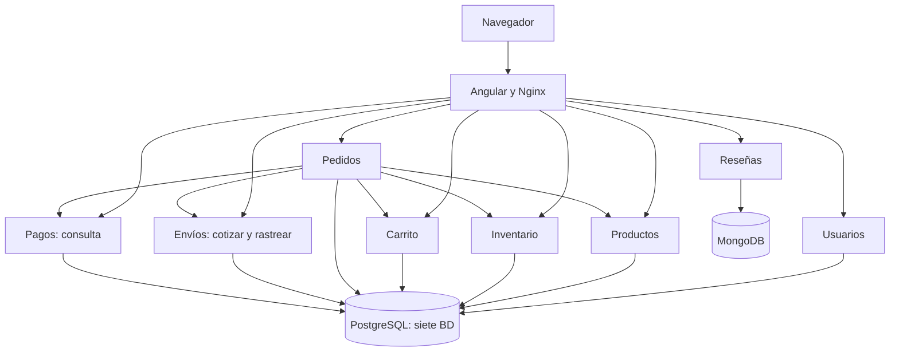

# Arquitectura

Monorepo con servicios independientes, REST/JSON y persistencia por dominio. El navegador usa rutas relativas `/api/...` a través de Nginx en el frontend. Las llamadas internas usan DNS de Compose o Services de Kubernetes y los puertos acordados.

El proxy no debe publicar operaciones internas. PostgreSQL compartido es un compromiso académico: usuarios y bases aislados, sin acceso cruzado; un fallo del motor afecta a siete servicios. MongoDB tiene su propia base. Volúmenes persistentes y migraciones por servicio.

Compose: red `red-tienda` y DNS por nombre. Publica en `127.0.0.1` (solo loopback del host) Usuarios `8001`, Productos `8002`, Envíos `8003`, Inventario `8004`, Carrito `8005`, Pedidos `8006`, Pagos `8007`, Reseñas `8008`, PostgreSQL `15432`, MongoDB `27017` y frontend `4200` (puertos de host predeterminados configurables para bases de datos, Usuarios y frontend). Así, las APIs y bases sirven para pruebas locales y no aceptan conexiones directas desde otros equipos. El frontend es el único punto de entrada previsto para tráfico externo en una red real; esta configuración Compose concreta también enlaza su puerto publicado al loopback, por lo que desde fuera del host no queda accesible sin ajustar la publicación o colocar un proxy de entrada.

Kubernetes: namespace `tienda`, Deployments y ClusterIP para APIs, StatefulSets/PVC para BD, ConfigMaps, Secrets y probes. Acceso local por port-forward al frontend o Ingress si se instala un controlador compatible. Imágenes etiquetadas por versión/commit. Un nodo permite probar réplicas y recuperación de Pods, no alta disponibilidad entre nodos. Docker Desktop con kubeadm ya validado; manifiestos aún pendientes.
