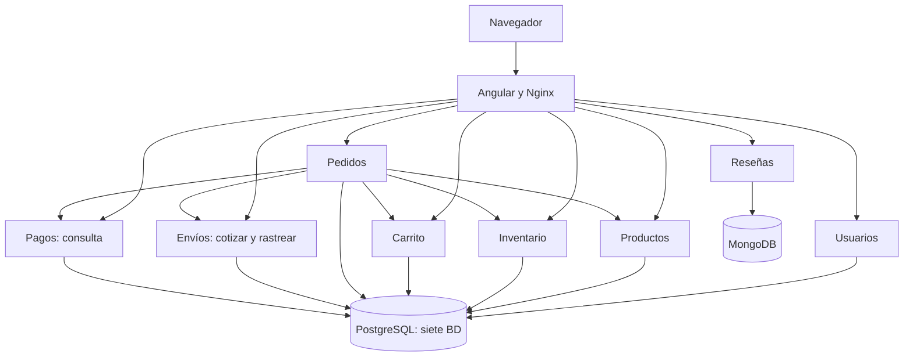

# Arquitectura

Monorepo con servicios independientes, REST/JSON y persistencia por dominio. El navegador usa rutas relativas `/api/...` a través de Nginx en el frontend. Las llamadas internas usan DNS de Compose o Services de Kubernetes y los puertos acordados.

El proxy no debe publicar operaciones internas. PostgreSQL compartido es un compromiso académico: usuarios y bases aislados, sin acceso cruzado; un fallo del motor afecta a siete servicios. MongoDB tiene su propia base. Volúmenes persistentes y migraciones por servicio.

Compose: red `red-tienda`, DNS por nombre, solo frontend publicado por defecto. Kubernetes: namespace `tienda`, Deployments y ClusterIP para APIs, StatefulSets/PVC para BD, ConfigMaps, Secrets y probes. Acceso local por port-forward al frontend o Ingress si se instala un controlador compatible. Imágenes etiquetadas por versión/commit. Un nodo permite probar réplicas y recuperación de Pods, no alta disponibilidad entre nodos. Docker Desktop con kubeadm ya validado; manifiestos aún pendientes.
